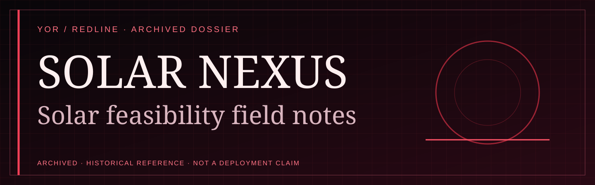
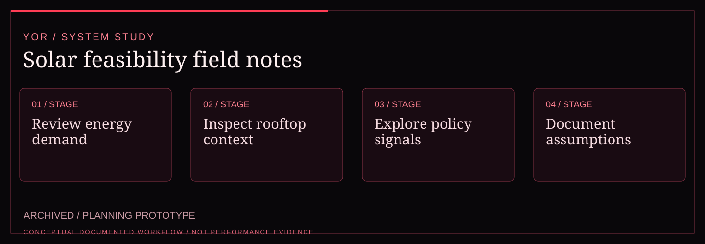

<!-- YOR REDLINE / README COVER V1 -->
<div align="center"><picture><source media="(max-width: 600px)" srcset="docs/yor-redline-cover-mobile.svg"/></picture>
<sub>YOR / PROJECT DOSSIER · ARCHIVED SOURCE</sub></div>
<!-- END YOR REDLINE -->

# YOR // Solar Nexus

Solar Nexus is a static, evidence-first planning prototype for exploring solar feasibility, energy demand, rooftop readiness, and policy signals. It gives the workflow a usable field surface while keeping unfinished calculations visibly unfinished.

<!-- YOR REDLINE / EXPERIENCE V2 -->

## System map

<div align="center"><picture><source media="(max-width: 600px)" srcset="docs/yor-redline-system-mobile.svg"/></picture></div>

| Signal | Documented boundary |
| :--- | :--- |
| Maturity | ARCHIVED / PLANNING PROTOTYPE |
| Technical focus | Static, evidence-first solar feasibility exploration, energy demand, rooftop readiness, and policy signals. |
| Evidence | Historical planning implementation; solar assumptions require external validation before real decisions. |

<!-- END YOR REDLINE / EXPERIENCE V2 -->

## Evidence boundary

| Surface | Status | What is actually verified |
| --- | --- | --- |
| Static landing and navigation | VERIFIED | Local HTML routes and internal links are checked by `scripts/check_design.py`. |
| Demo login feedback | DEMO | The browser-local credential branch reports a demo session; it creates no account or session. |
| Service route shells | DEMO | Feasibility, energy, subsidy, and rooftop pages explain the intended workflow. |
| Sample data and research notes | REPORTED | The repository contains placeholders only; no live tariff, irradiance, or policy feed is bundled. |
| Hosted deployment or cloud storage | UNVERIFIED | No deployment target or cloud connection is configured in this repository. |
| Decision-grade calculations, provider sync, and persistence | PLANNED | These require validated data sources, calculation review, and an operational backend. |

## Run locally

Serve `src/` with any static HTTP server, then open `/index.html`:

```powershell
python -m http.server 3023 --directory src
```

The visual and route contract can be checked without a server:

```powershell
python scripts/check_design.py
```

## Route map

| Route | Purpose |
| --- | --- |
| `/index.html` | Solar Nexus field hub |
| `/login.html` | Browser-local demo access gate |
| `/services/feasibility.html` | Location feasibility boundary |
| `/services/energy.html` | Energy demand boundary |
| `/services/subsidies.html` | Policy and subsidy boundary |
| `/services/rooftop.html` | Rooftop analysis boundary |

## YOR visual contract

The interface uses black void, graphite panels, crimson action states, warm-white text, signal labels, restrained grid/noise texture, square geometry, visible focus rings, and reduced-motion support. State language is intentionally explicit: `VERIFIED`, `DEMO`, `REPORTED`, `EXPERIMENTAL`, `UNVERIFIED`, and `PLANNED`.
