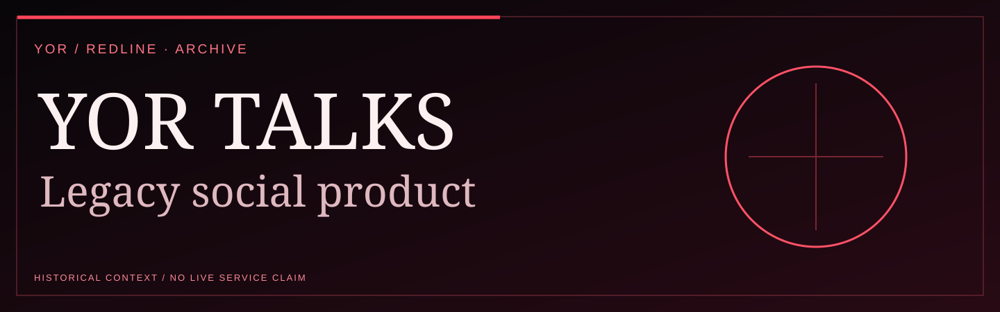
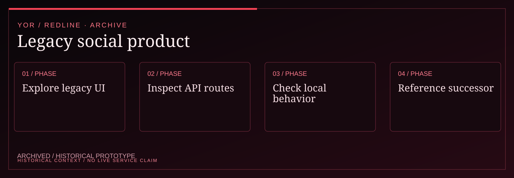

<!-- YOR REDLINE / README COVER V1 -->
<div align="center"><picture><source media="(max-width: 600px)" srcset="docs/yor-redline-cover-mobile.svg"/></picture>
<sub>YOR / PROJECT DOSSIER · ARCHIVED SOURCE</sub></div>
<!-- END YOR REDLINE -->

# YOR // Talks

YOR Talks is a React social-product prototype with a companion Express API. The repository contains a broad product surface, but this document separates what is verifiable locally from what still depends on seeded data, provider credentials, infrastructure, or real-user testing.

<!-- YOR REDLINE / EXPERIENCE V2 -->

## System map

<div align="center"><picture><source media="(max-width: 600px)" srcset="docs/yor-redline-system-mobile.svg"/></picture></div>

| Signal | Documented boundary |
| :--- | :--- |
| Maturity | ARCHIVED / HISTORICAL PROTOTYPE |
| Technical focus | React social-product surface, companion Express API, and locally bounded verification. |
| Evidence | The archive does not establish a maintained deployment, verified provider integrations, or a current beta. |

<!-- END YOR REDLINE / EXPERIENCE V2 -->

## Evidence boundary

| Surface | Status | What the repository can support |
| --- | --- | --- |
| Frontend build and YOR visual contract | VERIFIED | Vite build and `npm run design:check` validate the frontend bundle and visual tokens. |
| Auth, feed, profile, messaging, creator, live, shop, and admin UI | DEMO | Screens and interactions exist in the frontend; real state depends on the API and seed data. |
| Express routes, JWT, SQLite, Socket.IO, upload and security middleware | REPORTED | The source defines these boundaries; provider-backed behavior still needs runtime verification. |
| AI, email, payment, HLS/RTMP, uploads, and commerce providers | EXPERIMENTAL | Configuration hooks exist, but no provider credential or live transaction is asserted here. |
| Docker, hosted deployment, and production observability | UNVERIFIED | This checkout does not prove a deployed service or durable operational environment. |
| Production hardening and independent full-flow browser QA | PLANNED | Requires a controlled backend, seed strategy, provider sandbox, and multi-device review. |

## Quick start

Install both workspaces and run the frontend:

```bash
npm run install:all
npm run dev:frontend
```

The frontend is served at `http://localhost:5173`. It proxies `/api`, `/uploads`, and `/socket.io` to `http://localhost:5000`; start the backend separately when those flows are in scope:

```bash
cp backend/.env.example backend/.env
# Set a local JWT_SECRET before starting the API.
npm run dev:backend
```

The documented demo account is `yor@yortalks.com` / `password123`, but accepting those values is not evidence of a production auth system.

## Verification

```bash
npm run design:check
npm run build
```

The visual check confirms the YOR contract in the frontend source: black void, graphite panels, crimson actions, signal accents, warm-white text, restrained grid/noise texture, square geometry, visible focus states, and reduced-motion support. It also rejects external Google Fonts so the surface does not silently fall back to an unrelated visual identity.

## Product map

- `/auth` — demo entry point.
- `/` — authenticated social shell.
- `/creator-studio`, `/ai-studio`, `/live`, `/shop`, `/monetize` — extended product surfaces.
- `/admin`, `/analytics`, `/settings` — operational and account surfaces.
- `/messages` — conversation surface; Socket.IO requires the backend.

The repository is intentionally not described as a “billion-dollar” or production-ready platform. Those are aspirations, not verification results.
