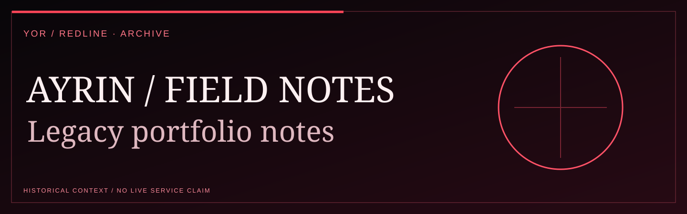
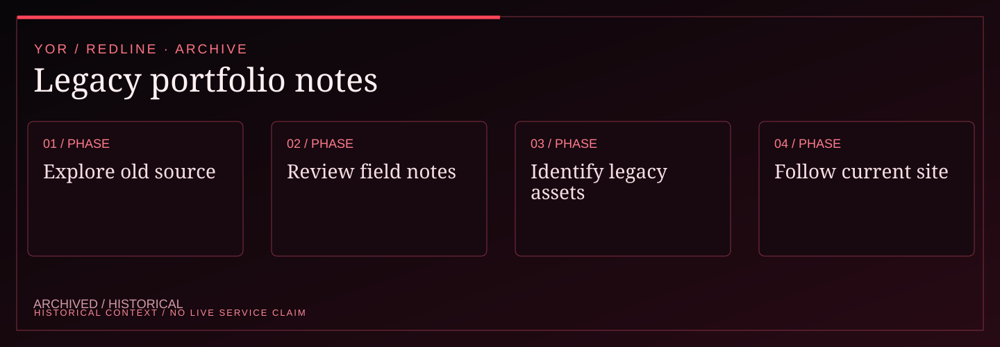

<!-- YOR REDLINE / README COVER V1 -->
<div align="center"><picture><source media="(max-width: 600px)" srcset="docs/yor-redline-cover-mobile.svg"/></picture>
<sub>YOR / PROJECT DOSSIER · ARCHIVED SOURCE</sub></div>
<!-- END YOR REDLINE -->

# YOR // Ayrin field notes

> A personal portfolio surface for shipped systems, experiments, and engineering notes.

| Surface / claim | State | Boundary |
|---|---|---|
| Next.js portfolio surface | VERIFIED | Production build and typed application boundary. |
| Project, skills, experience, and contact sections | DEMO | Presentation content is authored repository data. |
| Portfolio links and media | REPORTED | External targets and assets need live rechecking. |
| Motion and video hero | EXPERIMENTAL | Client-side enhancement; reduced-motion behavior remains supported. |
| Public deployment | UNVERIFIED | Hosting health is not established by a local build. |
| Additional data integrations | PLANNED | No external account sync is claimed here. |

The interface follows the YOR visual contract: `#000000` void, `#050505` graphite,
`#e84b4b` crimson, `#671515` deep crimson, `#ff8a7f` signal, `#f5eaea` warm white,
`#c4c4c4` muted text, and the `#671515 → #8c1616 → #2a0505` field gradient.
Run `npm run design:check` before shipping visual changes.

<!-- YOR REDLINE / EXPERIENCE V2 -->

## System map

<div align="center"><picture><source media="(max-width: 600px)" srcset="docs/yor-redline-system-mobile.svg"/></picture></div>

| Signal | Documented boundary |
| :--- | :--- |
| Maturity | ARCHIVED / HISTORICAL |
| Technical focus | Older Next.js portfolio and field-note source, retained as a previous iteration. |
| Evidence | Historical build and links do not supersede the current canonical portfolio. |

<!-- END YOR REDLINE / EXPERIENCE V2 -->

## Local run

```bash
npm ci
npm run dev
```
